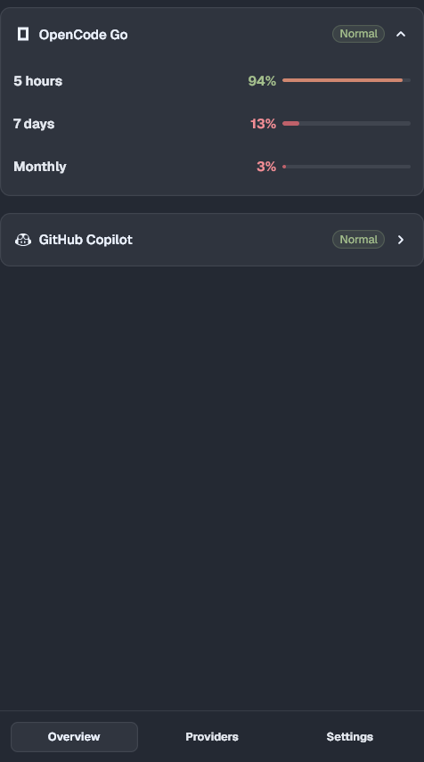

# Quota

English | [简体中文](README.zh-CN.md)

Remaining coding-agent quota in Tern's status line, with a native detail page.



Quota reads the logins your CLIs already keep on this machine, asks each
vendor's usage endpoint from the daemon, and renders the result with Tern's
native UI. One fetch covers every window; a broken or expired login never
hides the other providers.

## Features

- OpenCode Go, Claude, Codex, GitHub Copilot, Cursor, Gemini CLI and DeepSeek
- Custom OpenAI-compatible billing endpoints
- Status line with configurable remaining/used value, window label, reset
  countdown, percentage and network speed
- Five-hour, weekly and monthly windows where the provider exposes them
- Native providers, Providers and Settings pages; no web dashboard
- Read-only provider requests; no token refresh and no credential upload

## Install

From GitHub:

```sh
tern plugin install github.com/FR-HL/tern-quota
```

Or link a checkout while developing:

```sh
tern plugin link /path/to/tern-quota
tern plugin reload
```

Click the status segment, or run **Quota: Show details**, to open the detail
page. Preferences → Plugins can also install a directory or Git URL.

## Status line

The default segment combines the first window, its reset countdown and the
remaining percentage:

```text
OC 5h 4h32m 96%
```

A separate network module follows it:

```text
OC 5h 4h32m 96% | ↓ 2.3 MB/s ↑ 38 KB/s
```

Settings → **Status line** lets you choose:

- value: remaining or used
- show window label, reset countdown, percentage and network speed; the speed module has separate download/upload colors

For example, countdown plus remaining only:

```text
OC 4h32m 96%
```

Download and upload are separate status-line segments with their own color
settings and no extra icon. Network speed is sampled from the operating
system's adapter counters every few seconds. It is currently implemented with
PowerShell, so the speed module is Windows-only; quota segments work wherever
Tern runs.

## Providers

| Provider | Read from | Notes |
| --- | --- | --- |
| OpenCode Go | `~/.local/share/opencode/auth.json` | 5-hour, weekly and monthly windows |
| Claude | `~/.claude/.credentials.json` | 5-hour and weekly windows; uses the stored access token |
| Codex | `~/.codex/auth.json` | ChatGPT OAuth only; the WHAM endpoint is undocumented |
| GitHub Copilot | Copilot CLI `hosts.json`, else `gh auth token` | Premium requests, chat, completions |
| Cursor | `Cursor/auth.json` | Included and API usage |
| Gemini CLI | `~/.gemini/oauth_creds.json` | Code Assist quota; read-only, no token refresh |
| DeepSeek | Providers → **Key**, `DEEPSEEK_API_KEY`, or **Quota: Set DeepSeek API key** | Account balance (`¥`/`$`), no percentage windows |
| Custom endpoint | Providers → **Custom → Add** | OpenAI-compatible `dashboard/billing/subscription` + `usage` |

DeepSeek keys and custom endpoints use Tern's native prompt fields, so normal
clipboard paste works. The overview shows only providers that are signed in
and have quota to draw; every provider is listed on **Providers** with its own
**Sign in** or **Key** button.

## Commands

| Command | What it does |
| --- | --- |
| **Quota: Show details** | Opens the one detail page (or focuses it) |
| **Quota: Choose providers** | Opens the detail page on Providers |
| **Quota: Settings** | Opens the detail page on Settings |
| **Quota: Set DeepSeek API key** | Asks for the DeepSeek key with Tern's native prompt |
| **Quota: Refresh now** | Fetches immediately instead of waiting |

Only one detail page exists per window: clicking the status segment again
focuses it instead of opening another. Inside the page, `r` refreshes and
`q`/Esc closes it. Click a provider's header to fold it; the choice is
remembered.

## Detail page

The page has three tabs in the bottom dock:

- **Overview** — quota cards only. No login, key or provider settings.
- **Providers** — every provider with its own **Sign in** / **Key** button,
  plus **Hide/Show**. Hiding removes it from the overview and status bar; it
  does not sign you out. **Custom → Add** asks for name, base URL and key.
- **Settings** — refresh interval (1, 2 or 5 minutes), language (Auto,
  English, 中文), how the page opens (Floating by default; Tab, Docked), and
  the status-line format.

Settings live in the plugin's own `kv`, not in Tern's preferences. DeepSeek
keys and custom endpoint keys are stored there too; treat that folder as
private to your user account, not as a secret vault.

## Privacy and security

- Reads only the credential files listed above, capped at 64 KiB each.
- Provider tokens stay in memory for the request and are never written back.
- Provider usage results are cached in Tern's plugin data folder: percentages,
  reset times and 24 hours of history.
- DeepSeek and custom-endpoint keys are stored in the plugin's own `kv` so the
  daemon can refresh balances. They are sent only to the endpoint you chose.
- No Tern servers are involved.

## Limitations

- Codex and Copilot use undocumented endpoints; they can change without notice.
- Claude and Gemini tokens are used as stored; Quota does not refresh them.
  Re-run the provider CLI if a token expires.
- Quota is a window plugin: it reads the machine the window runs on, not a
  remote host's.
- Network speed is currently Windows-only.

## Development

Providers are plain Luau modules in `providers/`:

```lua
return {
  id = "example",
  name = "Example",
  short = "EX",              -- used in the status line
  icon = "provider-openai",  -- any Tern icon name
  windows = {
    { key = "hourly", label = "Hourly" },
  },
  detect = function(): boolean end,          -- optional: is a login present?
  fetch = function(done)                     -- call done exactly once
    -- read only the CLI's own credential file, call its usage endpoint
    done({ status = "ok", windows = { hourly = { used = 12, resets_at = "..." } } })
    -- or: done({ status = "auth" }) / done({ status = "error", error = "..." })
  end,
}
```

Add it to `PROVIDERS` in `host.luau`. Keep requests read-only and rate limited;
never write a credential.

## License and attribution

This project is **source-available, not OSI-approved open source**. It uses the
[PolyForm Noncommercial License 1.0.0](LICENSE); commercial use requires a
separate written license from the copyright holder.

- Required Notice: Copyright (c) 2026 FR-HL
  (https://github.com/FR-HL/tern-quota)
- Keep `LICENSE` and `NOTICE` with any copy.
- If you redistribute a modified version, link back to the original repository
  and clearly state your changes.

## Credits

- Built for [Tern](https://stencil.so/tern) by Stencil.
- Provider names, endpoints and CLI login formats belong to their respective
  vendors. Quota is an independent, unofficial client and is not endorsed by
  any provider.
- No vendor documentation text or credential files are bundled with this
  repository.
