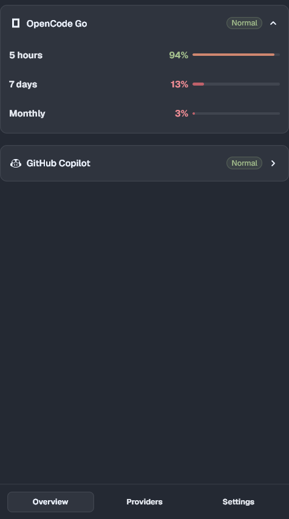

# Quota

[English](README.md) | 简体中文

在 Tern 状态栏显示 AI 编程套餐的剩余额度，并提供原生详情页。



Quota 只读取本机各 CLI 已经保存的登录信息，由 Tern 守护进程向各厂商的用量接口发起请求，再用 Tern 原生 UI 展示结果。一次请求覆盖所有窗口；某个登录失效不会影响其他服务商。

## 功能

- OpenCode Go、Claude、Codex、GitHub Copilot、Cursor、Gemini CLI、DeepSeek
- **概览**里的上下文区块直接读取 omp、Claude Code、Codex 的会话记录
- 概览顶部有服务商图标条：点一个只显示该服务商的额度和会话，点 **全部** 恢复
- 展开上下文详情后显示上下文 token 历史和对应服务商剩余额度历史图表
- 可插拔适配器：`providers/`、`sources/`、`contexts/` 下的每个 `.luau` 自动加载
- Magpie 的服务商通过本地额度接口自动出现，包括 Open Design 和插件管理的账号
- 一个自定义接口，自动识别 New API / One API 中转或 OpenAI 计费接口
- 状态栏可配置：剩余/已用、窗口名称、重置倒计时、百分比、网速
- 服务商支持时显示 5 小时、每周、每月窗口
- 原生概览、服务商、设置页，不另开网页面板
- 对服务商只读请求，不刷新 Token，不上传凭据

## 安装

从 GitHub 安装：

```sh
tern plugin install github.com/FR-HL/tern-quota
```

开发时直接链接本地目录：

```sh
tern plugin link /path/to/tern-quota
tern plugin reload
```

点击状态栏额度段，或在命令面板运行 **Quota: Show details**，打开详情页。也可以在 **Preferences → Plugins** 里安装 Git 地址或本地目录。

## 状态栏

默认把第一个窗口、重置倒计时和剩余额度放在同一个模块里：

```text
OC 5h 4h32m 96%
```

网速是另一个独立模块：

```text
OC 5h 4h32m 96% | ↓ 2.3 MB/s ↑ 38 KB/s
```

在 **Settings → Status line** 可以选择：

- 数值：剩余或已用
- 名称：短代码（默认，`OC`、`OD`、`CX`）、完整服务商名称或隐藏
- 图标：显示或隐藏每个状态栏片段前的服务商图标
- 是否显示窗口名称、重置倒计时、百分比、网速，以及下载/上传方向各自的颜色

窗口标签统一为 `5h`、`7d`、`mo`，OpenCode 和 Open Design 格式一致：

```text
OD 5h 2h51m 93% | OC 5h 2h41m 91%
```

例如只显示倒计时和剩余额度：

```text
OC 4h32m 96%
```

下载和上传是两个独立着色的状态栏片段，没有额外图标；网速来自操作系统网卡计数器，每几秒采样一次。目前用 PowerShell 实现，因此网速模块只支持 Windows；额度模块在 Tern 支持的平台上可用。

## 服务商

| 服务商 | 读取位置 | 说明 |
| --- | --- | --- |
| OpenCode Go | `~/.local/share/opencode/auth.json` | 5 小时、每周、每月窗口 |
| Claude | `~/.claude/.credentials.json` | 5 小时和每周窗口；使用已保存的 access token |
| Codex | `~/.codex/auth.json` | 仅 ChatGPT OAuth；WHAM 接口未公开 |
| GitHub Copilot | Copilot CLI 的 `hosts.json`，否则 `gh auth token` | 高级请求、聊天、补全 |
| Cursor | `Cursor/auth.json` | Included 和 API 用量 |
| Gemini CLI | `~/.gemini/oauth_creds.json` | Code Assist 额度；只读，不刷新 Token |
| DeepSeek | 服务商页 **密钥**、`DEEPSEEK_API_KEY`，或 **Quota: Set DeepSeek API key** | 账户余额（`¥`/`$`），没有百分比窗口 |
| Magpie | `http://127.0.0.1:3425/v1/magpie/quotas` | 自动发现；包含 Open Design 和 Magpie 管理的插件服务商 |
| 自定义接口 | 服务商页 **Custom → 添加接口** | 自动识别 New API 的 `/api/usage/token/` 或 OpenAI 的 `dashboard/billing` |

DeepSeek 密钥和自定义接口都使用 Tern 原生输入框，支持正常粘贴。概览只显示已登录且有额度可画的服务商；所有服务商都会出现在 **Providers** 页。每个服务商只有一个状态图标：正常时显示对勾；未登录或登录失效时，同一个图标就是登录/密钥操作，不会再同时出现“登录”和“未登录”两个按钮。后面的网格图标控制概览，仪表图标控制状态栏，悬停可看文字说明。Magpie 项是只读的，并标记为 **自动**。

## 命令

| 命令 | 作用 |
| --- | --- |
| **Quota: Show details** | 打开唯一的详情页，或聚焦已打开的详情页 |
| **Quota: Choose providers** | 在详情页打开 Providers |
| **Quota: Settings** | 在详情页打开 Settings |
| **Quota: Set DeepSeek API key** | 用 Tern 原生输入框询问 DeepSeek Key |
| **Quota: Refresh now** | 立即刷新，不等定时器 |

每个窗口只有一个详情页：再次点击状态栏额度段会聚焦它，不会重复打开。详情页内按 `r` 刷新，按 `q`/Esc 关闭。点击服务商标题可折叠，折叠状态会记住。

## 详情页

底部 dock 有三个标签：

- **Overview**：顶部服务商图标条可筛选页面；下面是额度卡片，再下面是 **上下文** 区块，读取各 Agent 自己最近的会话记录（每个最多 8 条）：omp、Claude Code、Codex；显示服务商图标、模型名（不带服务商前缀）、已用/窗口、百分比和更新时间；点击卡片可查看服务商、完整模型、精确时间、会话文件路径，以及上下文 token 历史和对应服务商剩余额度历史图表。没有登录、Key 或配置。
- **Providers**：每个服务商只有一个状态图标：正常时是对勾，异常时同一个图标就是登录/密钥操作；之后是 **网格**（概览）和 **仪表**（状态栏）两个可见性开关，悬停显示文字，两者都不会退出登录。**Custom → 添加接口** 用 Tern 原生输入框依次询问名称、地址和 Key，然后自动识别额度协议。
- **Settings**：刷新间隔（1/2/5 分钟）、语言（Auto、English、中文）、打开方式（默认 Floating，也可 Tab、Docked），以及状态栏格式。

设置保存在插件自己的 `kv`，不写入 Tern 首选项。DeepSeek Key 和自定义接口 Key 也存在这里；请把这个目录当作私人数据，而不是系统密钥库。

## 隐私与安全

- 只读取上面列出的凭据文件，每个文件最多 64 KiB。
- 服务商 Token 只在请求期间留在内存，不写回。
- 服务商用量结果缓存在 Tern 插件数据目录：百分比、重置时间和 24 小时历史。
- DeepSeek 和自定义接口的 Key 存在插件自己的 `kv`，只发送给你选择的接口。
- 不经过任何 Tern 服务器。

## 限制

- Codex 和 Copilot 使用未公开接口，可能随时变化。
- Claude 和 Gemini 使用已保存的 Token，Quota 不负责刷新；Token 过期时请重新运行对应 CLI。
- Quota 是窗口插件：读取窗口所在机器的数据，不读取远程主机。
- 上下文显示各 Agent 最近的会话（每个最多 8 条），不一定对应某个 pane；并行会话时可能有歧义。
- 上下文适配器目前覆盖 omp、Claude Code、Codex；其他 Agent 需要自己加适配器。窗口未知时仍显示已用 token，但不显示百分比。
- 剩余额度历史从插件首次运行开始记录；Agent 本地日志没有可回溯的成本历史，花费图表需要成本来源。
- 网速目前仅支持 Windows。

## 开发

服务商、数据源和上下文都是普通 Luau 模块。`providers/`、`sources/`、
`contexts/` 下的每个 `.luau` 都会自动加载，不需要改列表。

```lua
return {
  api = 1,
  id = "example",
  name = "Example",
  short = "EX",              -- 状态栏显示名
  icon = "provider-openai",  -- 任意 Tern 图标名
  windows = {
    { key = "hourly", label = "Hourly" },
  },
  fetch = function(done)     -- 必须且只能调用一次 done
    done({ status = "ok", windows = { hourly = { used = 12 } } })
  end,
}
```

上下文适配器读取各 Agent 自己的会话记录，返回
`{ agent, project, model, used, window, at }`。完整接口、公开 JSON 格式和
`models.json` 覆盖方式见 [`docs/adapters.md`](docs/adapters.md)。请求必须只读，禁止写回凭据。

## 许可与署名

本项目使用 [MIT License](LICENSE) 开源。

你可以使用、复制、修改、合并、发布、分发、再许可和销售，包括闭源和商业版本，只要保留 `LICENSE` 中的版权和许可声明。

## 致谢

- 基于 [Tern](https://stencil.so/tern)（Stencil）开发。
- 各服务商名称、接口和 CLI 登录格式归各自厂商所有。Quota 是独立非官方客户端，未获得任何厂商背书。
- 仓库不包含厂商文档正文或真实凭据。
